# ha-alarm-card

[](https://github.com/hacs/integration)
[](https://github.com/juju35/ha-alarm-card/actions/workflows/hacs.yml)
[](https://github.com/juju35/ha-alarm-card/actions/workflows/validate.yml)
[](https://github.com/juju35/ha-alarm-card/releases/latest)
[](LICENSE)

Lovelace cards for Home Assistant to arm and disarm an alarm: state, exit and entry delay countdown, code pad, open sensors and who changed it last.

The cards work with any [alarm control panel](https://www.home-assistant.io/integrations/alarm_control_panel/) ([Alarmo](https://github.com/nielsfaber/alarmo), [Manual](https://www.home-assistant.io/integrations/manual/), Verisure, Ajax…): the arm modes come from the panel's supported features and the keypad from its code format. Alarmo's extra information (delays, open and bypassed sensors, last trigger, who changed it) is shown when the panel provides it.

[](https://my.home-assistant.io/redirect/hacs_repository/?owner=juju35&repository=ha-alarm-card&category=plugin)

| Alarm Card | Alarm Mini Card |
|---|---|
|  |  |

## Features

- Two cards: a full **Alarm Card** and a compact, single-row **Alarm Mini Card** (state, countdown and one-tap buttons)
- Detail button at the top right of the mini card: it switches to the full card and back; a click anywhere outside the card brings the compact view back
- State shield colored by state and mode (disarmed, home, away, night, vacation, custom), pulsing during the exit / entry delay, flashing when the alarm goes off
- One button per supported arm mode, and Disarm (Cancel during the exit delay)
- Exit and entry delay countdown with a progress bar (Alarmo's `delay`, or the `expiration` attribute)
- Code pad when the panel needs a code: digits for a number code, a password field otherwise
- Sensors of your choice (doors, windows, motion, smoke, leak) with their state; arming with a sensor open asks first ("Kitchen window: open. Arm away anyway?") and, with Alarmo, forces the arming
- Open and bypassed sensors reported by Alarmo, last trigger, who changed the state and since when
- Optional confirmation before disarming
- Collapsible sensors section
- Click the state or a sensor to open its more-info dialog
- Visual editor in the dashboard UI for both cards (no YAML needed)
- Light and dark mode, English, French, German and Spanish, reduced-motion aware
- Single file, no external dependency

## Prerequisites

Home Assistant 2024.8 or later, with an alarm control panel (Alarmo recommended).

## Installation

### Via HACS (recommended)

Click the button below to add the repository directly:

[](https://my.home-assistant.io/redirect/hacs_repository/?owner=juju35&repository=ha-alarm-card&category=plugin)

Then click **Download**, and reload your browser when HACS asks you to.

Or manually:

1. Open HACS → **⋮** (top right) → **Custom repositories**
2. Add `https://github.com/juju35/ha-alarm-card` — Type: **Dashboard**
3. Search for **Alarm Card** and click **Download**
4. Clear your browser cache and refresh

### Manual

1. Download `alarm-card.js` from the [latest release](https://github.com/juju35/ha-alarm-card/releases/latest)
2. Copy it to `/config/www/alarm-card.js`
3. Go to **Settings → Dashboards → ⋮ → Resources** → Add resource:
   - URL: `/local/alarm-card.js`
   - Type: **JavaScript Module**
4. Clear your browser cache and refresh

## Configuration

### Visual editor

Edit a dashboard, click **Add card** and search for **Alarm Card** or **Alarm Mini Card**. The first alarm panel is preselected; pick the arm modes to show, the sensors to display and the options. Options left at their default are kept out of the generated YAML.

### Minimal

```yaml
type: custom:alarm-card
```

```yaml
type: custom:alarm-mini-card
```

### Full options

```yaml
type: custom:alarm-card
entity: alarm_control_panel.alarmo
title: Alarm
modes:
  - away
  - home
sensors:
  - binary_sensor.front_door
  - entity: binary_sensor.kitchen_window
    name: Kitchen
  - binary_sensor.hallway_motion
show_logo: true
show_controls: true
show_sensors: true
show_info: true
confirm_disarm: false
collapsed: false
language: fr
```

```yaml
type: custom:alarm-mini-card
entity: alarm_control_panel.alarmo
sensors:
  - binary_sensor.front_door
  - binary_sensor.kitchen_window
confirm_disarm: true
zoom: true
```

### Options reference

| Option | Card | Default | Description |
|---|---|---|---|
| `entity` | both | First alarm panel | `alarm_control_panel` entity |
| `title` | both | Panel name | Card title |
| `modes` | both | All supported | Arm modes to show, among `home`, `away`, `night`, `vacation`, `custom_bypass` (`arm_` prefix optional); modes the panel does not support are ignored |
| `sensors` | both | — | Binary sensors to display and to check before arming: entity ids, or `{ entity, name }` |
| `show_logo` | both | `true` | Show the card logo |
| `show_controls` | both | `true` | Arm / disarm buttons |
| `show_info` | both | `true` | Who changed the state and the last trigger (Alarmo) |
| `confirm_disarm` | both | `false` | Ask for confirmation before disarming |
| `show_sensors` | both | `true` | Sensors section (on the mini card: in its zoomed view) |
| `collapsed` | both | `false` | Fold the sensors section by default, click its title to unfold it (on the mini card: in its zoomed view) |
| `zoom` | mini | `true` | Detail button at the top right of the mini card: it shows the full card's content (with the same options) and switches back; `false` removes it |
| `language` | both | Auto | Force language: `en`, `fr`, `de` or `es` (auto-detects from HA settings) |

## Screenshots

The shield animates with the panel's state: it flashes while the alarm is triggered and pulses while arming (and during the entry delay). It settles to a still card once disarmed, and honours `prefers-reduced-motion`.

| | Light | Dark |
|---|---|---|
| Triggered (flashing) | 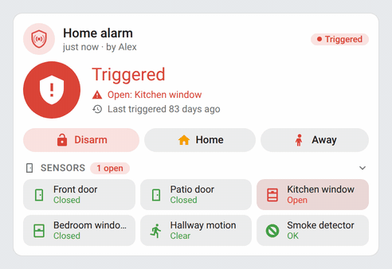 |  |
| Arming (pulsing) | 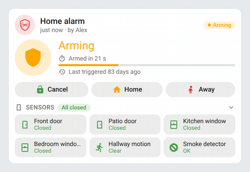 | 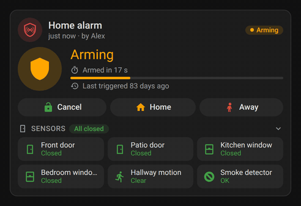 |

| Light | Dark (arming: exit delay countdown) |
|---|---|
| 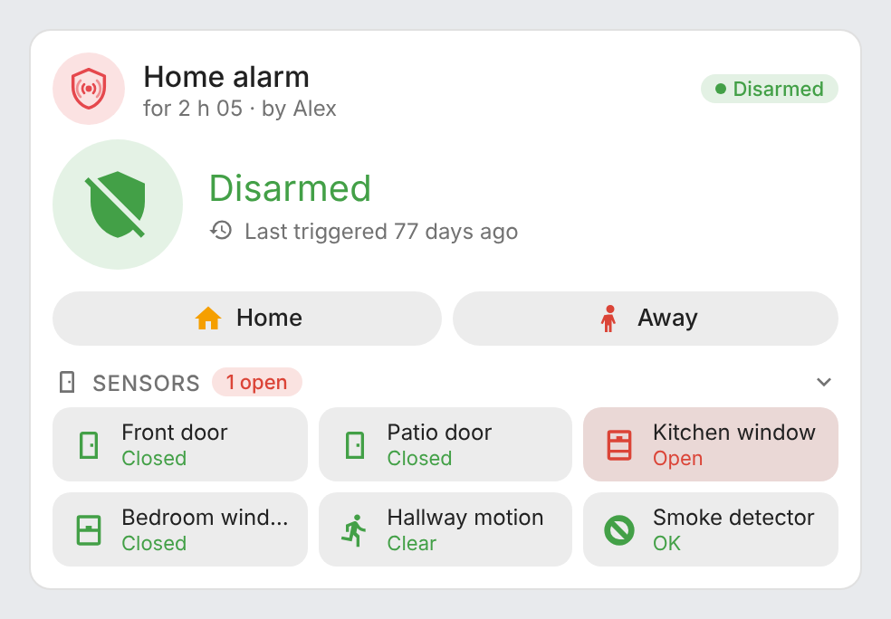 | 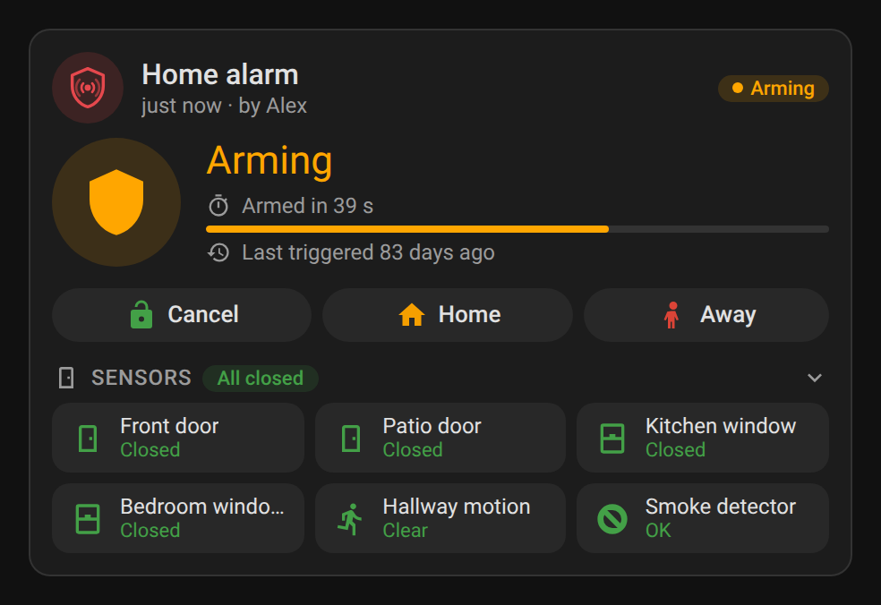 |
| 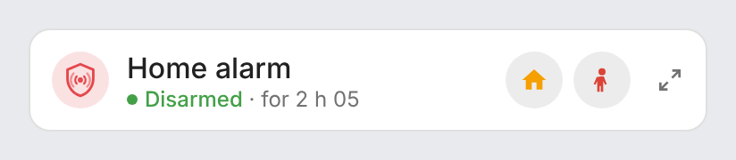 | 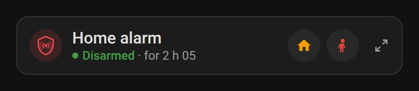 |

Armed away and triggered:

| Light | Dark |
|---|---|
| 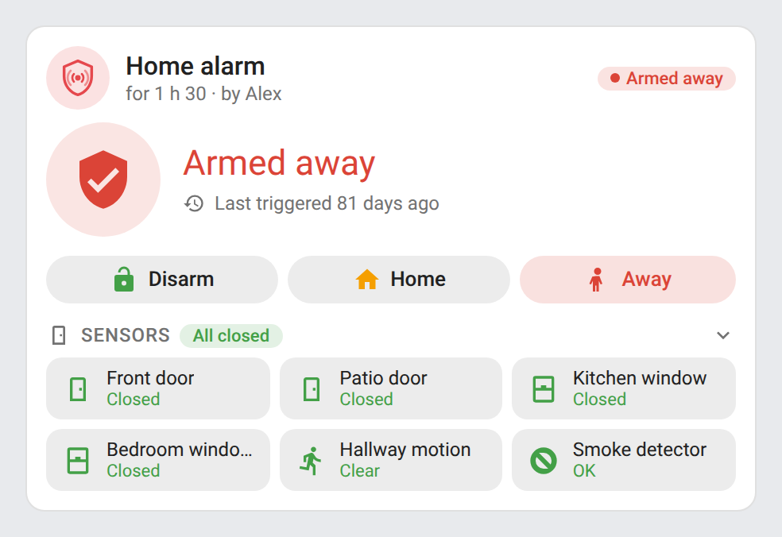 | 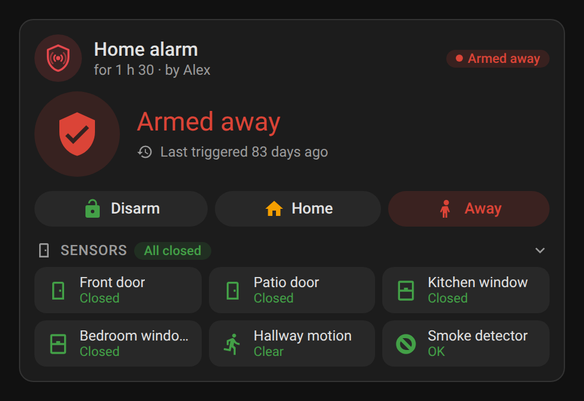 |
| 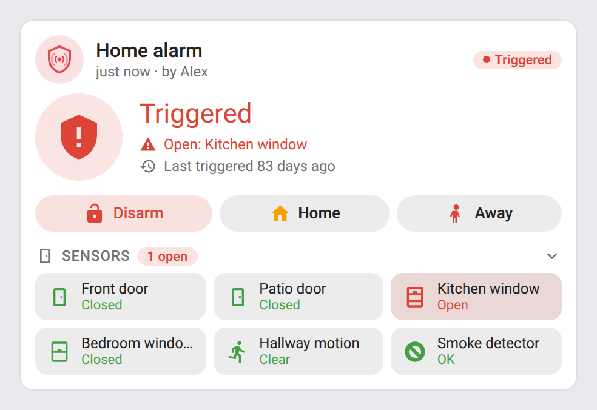 | 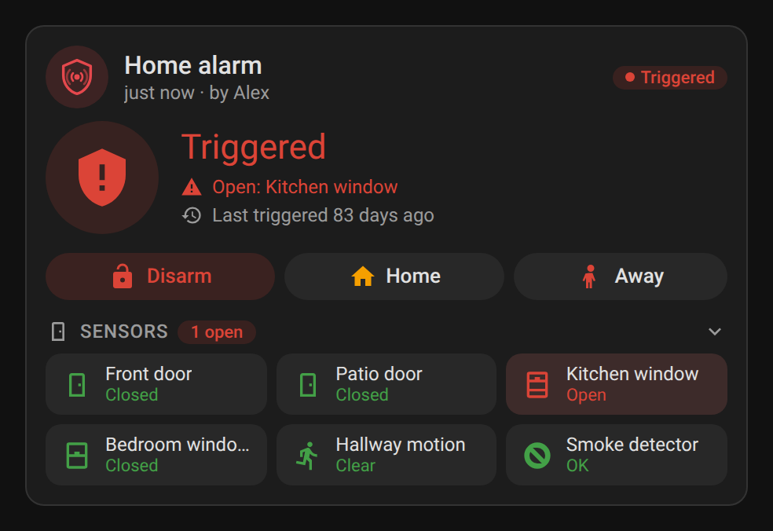 |

Code pad (panel with a number code):

| Light | Dark |
|---|---|
| 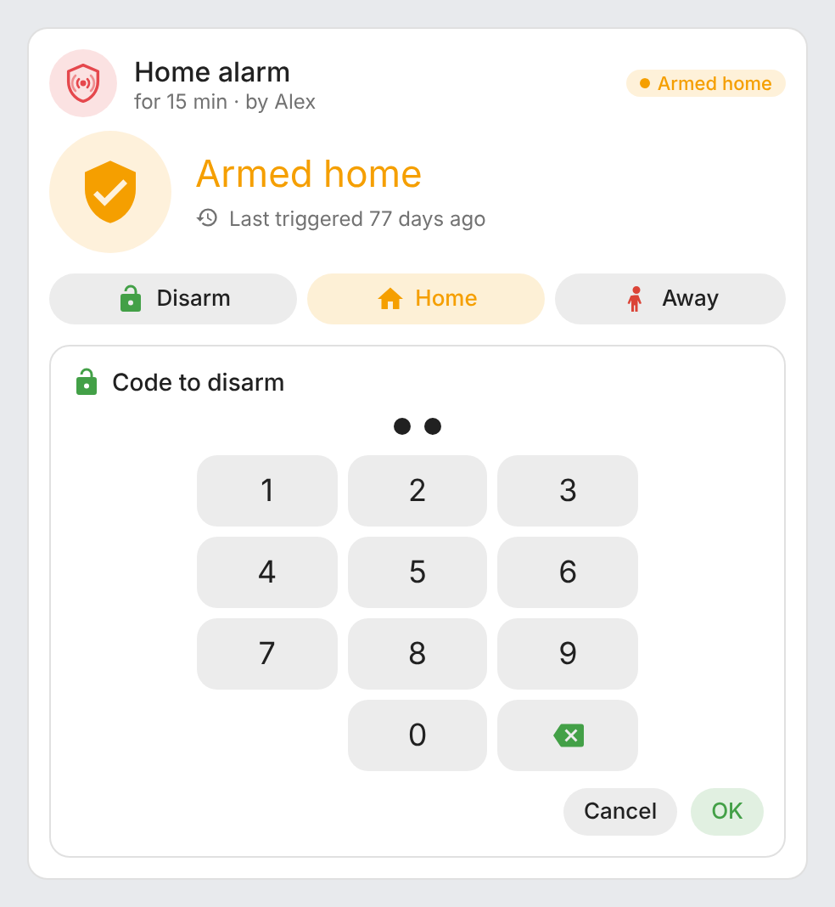 | 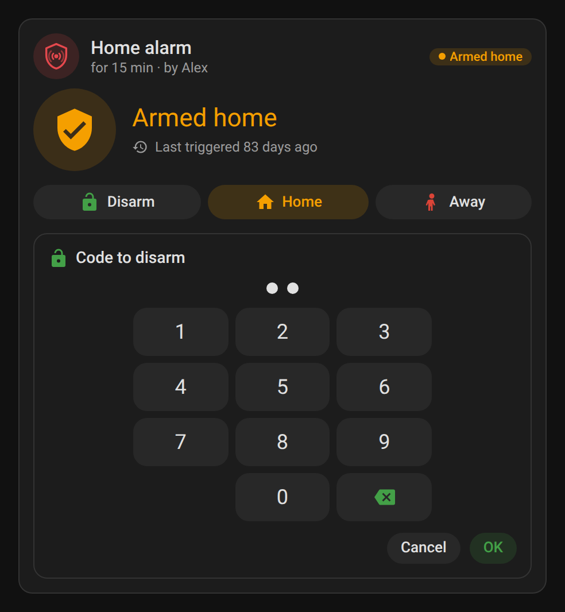 |

Mini card zoomed in with its detail button (top right, click it again or anywhere outside the card to go back):

| Light | Dark |
|---|---|
| 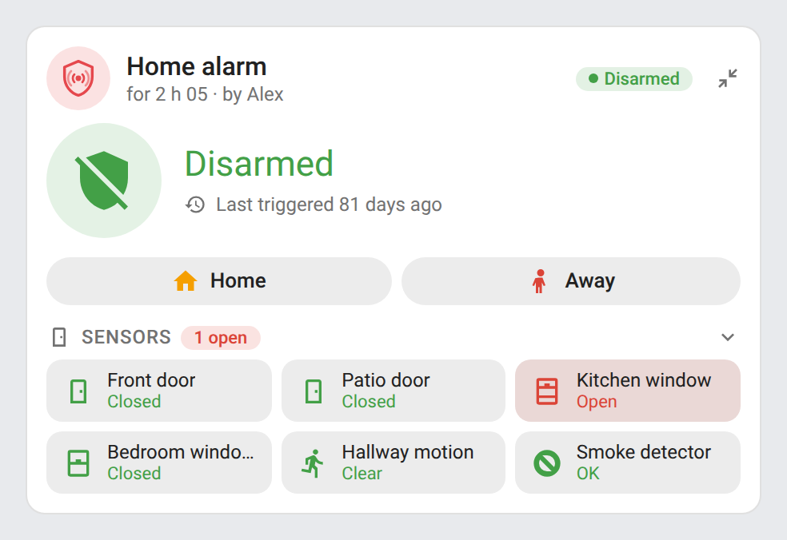 | 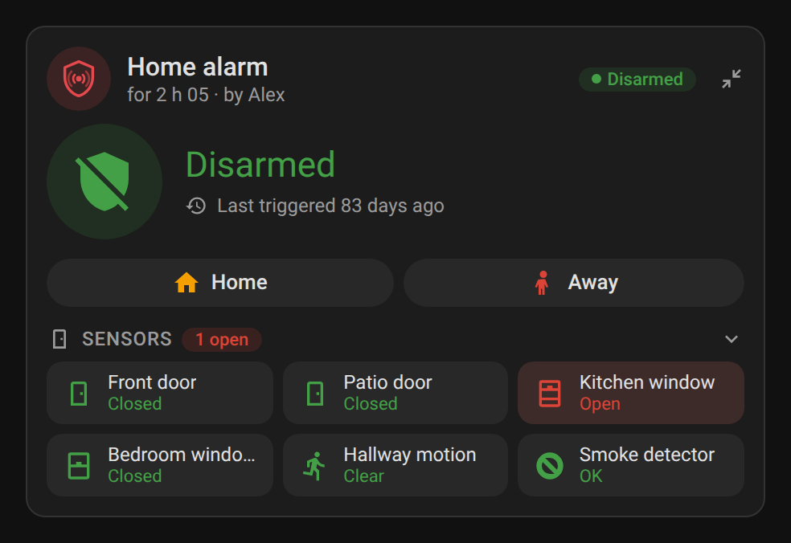 |

## How it works

- **Modes**: the buttons follow the panel's `supported_features` (home, away, night, vacation, custom bypass), narrowed by `modes`.
- **Code**: when the panel has a `code_format`, Disarm opens the code pad, and so do the arm buttons unless `code_arm_required` is `false`. The code is sent with the standard `alarm_control_panel.alarm_*` services; a wrong code is reported by Home Assistant.
- **Open sensors**: before arming, the card checks the configured `sensors`. When one is open it asks for confirmation; once confirmed, an Alarmo panel is armed with `alarmo.arm` and `force: true` (the standard service would be refused), other panels with the standard service.
- **Unavailable sensors**: Alarmo also reports sensors that are unavailable, or that no longer exist under the entity_id it was set up with, among its open sensors (they block arming). The card lists them on a separate "Unavailable" line; if an entity_id is shown there, update that sensor in Alarmo's settings.
- **Delays**: during `arming` (exit delay) and `pending` (entry delay), the card counts down from Alarmo's `delay` attribute and the last state change, or from an `expiration` attribute.
- **Updates**: the card only redraws when the panel, its sensors or the countdown change, and patches the page in place (no flicker, the code field keeps what you typed).

## Development

```bash
npm install
npm run build        # bundles src/alarm-card.js into dist/alarm-card.js
npm run check        # builds and checks the card (run in CI)
npm test             # unit tests (node --test)
npm run screenshots  # renders the cards with mock data (scripts/mock-states.mjs) into screenshots/ (and the triggered/arming GIFs, needs ffmpeg)
```

`dist/` is not committed: `npm run build` creates it locally, CI builds it on every push, and the release workflow attaches the built file to the release, which is where HACS downloads it from.

### Releasing

1. Bump `version` in `package.json`
2. Add a `## <version>` section at the top of [CHANGELOG.md](CHANGELOG.md)
3. Push to `main`: the **Release** workflow builds the card, creates the tag and the GitHub release with the changelog section as notes, and attaches `alarm-card.js`

## Translations

The cards auto-detect the language from your Home Assistant settings. Currently supported:

| Language | Code |
|---|---|
| English | `en` |
| Français | `fr` |
| Deutsch | `de` |
| Español | `es` |

Contributions for additional languages are welcome!

## License

[MIT](LICENSE)
